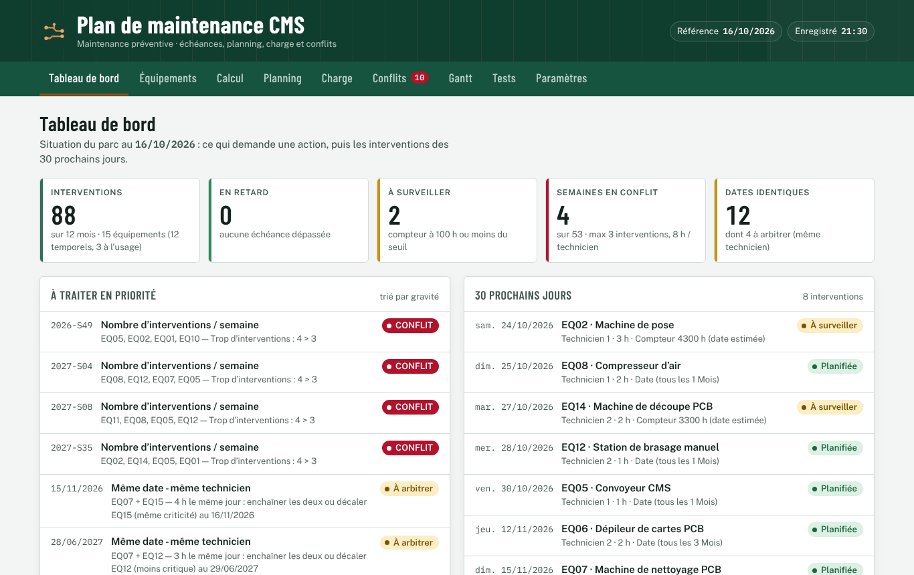

# Plan de maintenance CMS

Générateur de **plan de maintenance préventive** pour une ligne de production CMS (montage en surface de composants électroniques). Il est issu du classeur Excel/VBA du *Sujet 2, séances 5 et 6*, et il est disponible :
- en **application web** ;
- en **PWA installable**, utilisable hors ligne ;
- en **application Android**.



## Fonctions

| Onglet | Rôle |
|---|---|
| **Tableau de bord** | Indicateurs, actions prioritaires, interventions des 30 prochains jours, charge par semaine |
| **Équipements** | Ajouter, modifier et supprimer une machine, avec sa gamme d'opérations. Validation des saisies et annulation possible |
| **Calcul** | Prochaine échéance et 4 dates futures. Périodicité **temporelle** (mois, semaines, jours, ans) ou **d'usage** (compteur d'heures, usage moyen estimé) |
| **Planning** | Toutes les interventions sur 12 mois, avec filtres par technicien et par état, recherche et **export CSV** |
| **Charge** | Heures par technicien et par semaine, avec la capacité maximale |
| **Conflits** | Retards, compteurs proches du seuil, semaines surchargées, équipements prévus le même jour (avec une proposition de décalage) |
| **Gantt** | Calendrier visuel sur 53 semaines ISO |
| **Tests** | Les 19 vérifications du moteur (équivalent de la macro `TesterMoteur`) |
| **Paramètres** | Réglages du calcul, sauvegarde et restauration JSON, synchronisation optionnelle entre appareils |

Les résultats du moteur sont **identiques à ceux de la macro VBA**. Au 16/10/2026, on obtient 88 interventions, 4 semaines en conflit et 12 dates identiques. Cette concordance est vérifiée ligne par ligne par les tests automatiques.

## Démarrage rapide

Prérequis : **Node.js 22** ou plus récent.

```bash
npm install
npm start            # build + serveur local → http://localhost:4173
```

| Commande | Effet |
|---|---|
| `npm run build` | Construit `dist/`, prêt pour Vercel et Android |
| `npm test` | Tests unitaires et tests de bout en bout |
| `npm run test:sql` | Teste la migration Supabase sur PostgreSQL |
| `npm run android:sync` | Build, puis copie dans le projet Android |
| `npm run android:apk` | Compile l'APK de test (nécessite Android Studio ou le SDK Android) |

## Installer l'application

- **PC (Windows, macOS, Linux)** : ouvrez l'adresse en ligne dans Chrome ou Edge, puis cliquez sur **Installer l'application** dans l'en-tête, ou sur l'icône d'installation de la barre d'adresse.
- **Android** :
  - soit la **PWA** : dans Chrome, menu ⋮, puis **Installer l'application** ;
  - soit l'**APK**, téléchargé depuis l'onglet *Actions* ou *Releases* du dépôt GitHub.

Détails dans [docs/INSTALLATION.md](docs/INSTALLATION.md).

## Structure

```
web/                 application (HTML, CSS, JS sans framework, données, icônes, manifest, service worker)
  js/moteur.js       moteur de calcul (traduction du module VBA)
  js/app.js          interface
  js/donnees.js      validation, migration, enregistrement local
  js/plateforme.js   navigateur ou Android (export, hors ligne, installation)
  js/sync.js         synchronisation Supabase optionnelle
android/             projet Android (Capacitor 8), identifiant tn.planmaintenance.cms
supabase/migrations/ table « plans » + Row Level Security
vba/                 classeur Excel et module VBA d'origine
scripts/             build, serveur local, icônes, polices, captures, test SQL
tests/               unitaires (node:test) et bout en bout (Playwright + axe)
docs/                guides utilisateur (FR/EN), installation, développement, déploiement, mise à jour, dépannage
.github/workflows/   CI (tests) et compilation de l'APK
```

## Déploiement

- **GitHub et Vercel** : [docs/DEPLOYMENT_GUIDE.md](docs/DEPLOYMENT_GUIDE.md). Il suffit d'importer le dépôt dans Vercel ; `vercel.json` contient tout le reste.
- **APK Android** : le workflow `.github/workflows/android.yml` le compile à chaque envoi sur `main`.
- **Synchronisation (optionnelle)** : créez un projet Supabase, exécutez la migration, puis renseignez `SUPABASE_URL` et `SUPABASE_ANON_KEY`.

## Documentation

- **[Guide de lancement et de publication — HTML, FR / AR](docs/guide-lancement-publication.html)**
- [Guide utilisateur (FR)](docs/USER_GUIDE.md) · [User guide (EN)](docs/en/USER_GUIDE.md)
- [Installation](docs/INSTALLATION.md)
- [Guide développeur](docs/DEVELOPER_GUIDE.md)
- [Déploiement](docs/DEPLOYMENT_GUIDE.md)
- [Mise à jour](docs/MISE_A_JOUR.md)
- [Dépannage](docs/TROUBLESHOOTING.md)
- [Rapport d'audit](docs/AUDIT.md)
- [Rapport de tests](docs/RAPPORT_TESTS.md)
- [Prompt adapté (web + Android)](docs/PROMPT_ADAPTE.md)

## Licence

[MIT](LICENSE). Les polices sont sous licence SIL Open Font License 1.1.
