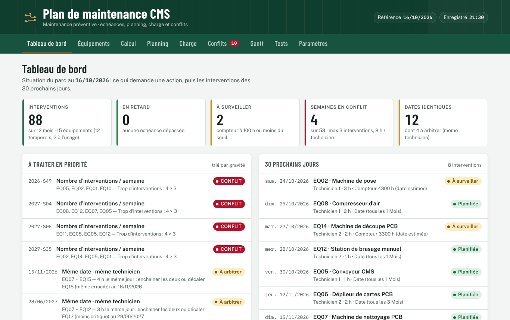
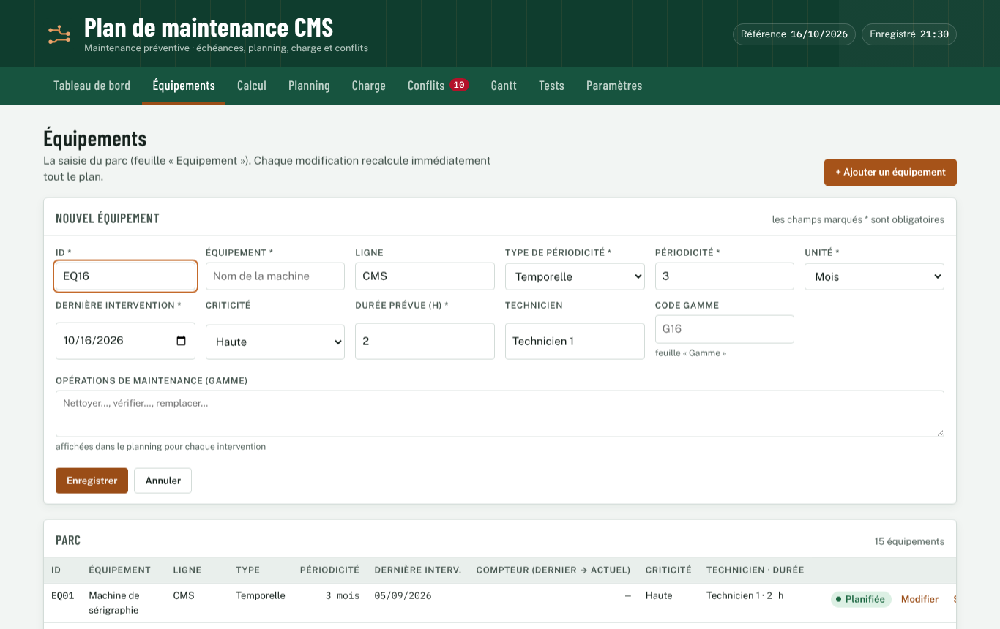
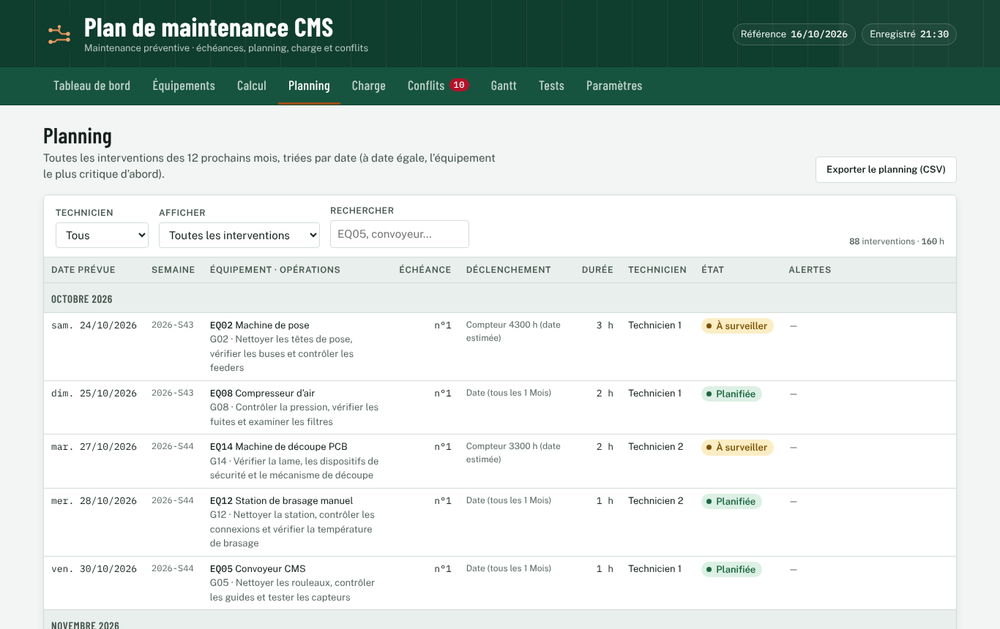
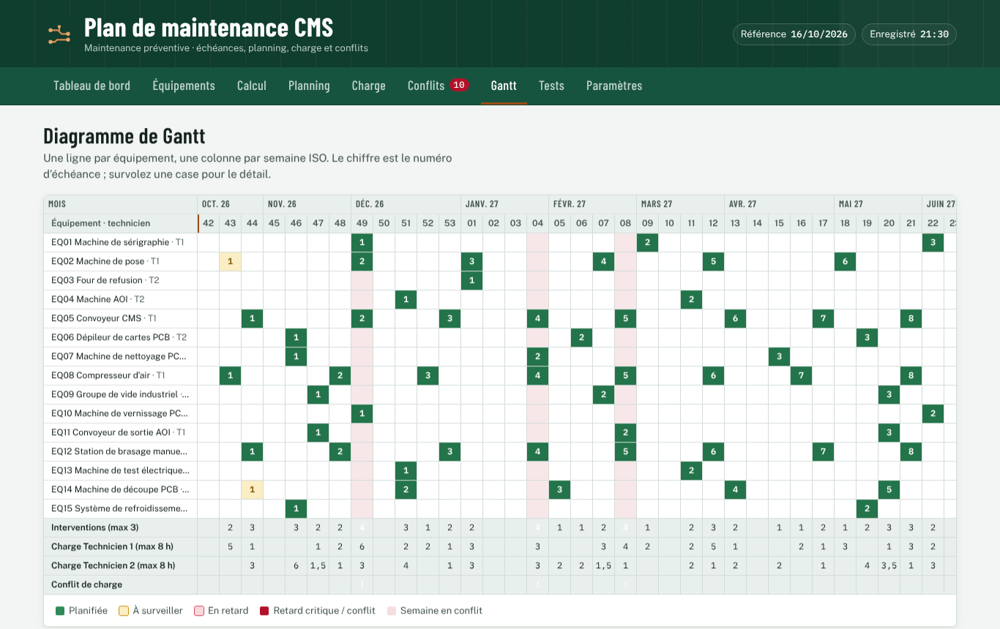
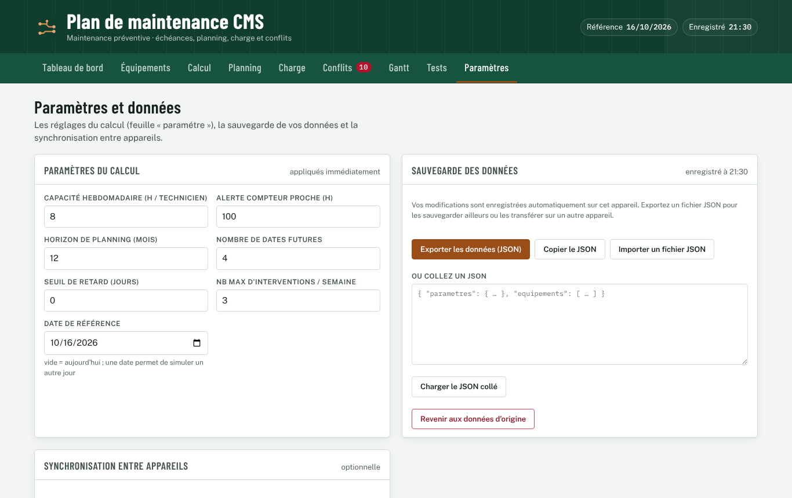

# Guide d'utilisation — Plan de maintenance CMS

*English version: [en/USER_GUIDE.md](en/USER_GUIDE.md)*

## 1. Présentation

L'application calcule **quand entretenir chaque machine** d'une ligne CMS. Elle répartit le travail entre les techniciens et signale les problèmes : retards, semaines surchargées, interventions prévues le même jour.

Elle reprend exactement les règles du classeur Excel du Sujet 2. Il existe deux types de périodicité :
- **Temporelle** : l'intervention revient à intervalle fixe, par exemple « tous les 3 mois ». Les dates sont calculées depuis la dernière intervention.
- **Usage** : l'intervention revient selon le compteur d'heures, par exemple « toutes les 500 h ». L'application estime la date à partir de l'usage moyen par jour.

Vos données restent **sur votre appareil**. Aucun compte n'est nécessaire.

Les couleurs ont le même sens dans tous les onglets :

| Couleur | Sens |
|---|---|
| Vert | Planifiée |
| Jaune | À surveiller (compteur proche du seuil) ou À arbitrer (même technicien le même jour) |
| Rose | En retard |
| Rouge | Retard critique (une période entière manquée) ou CONFLIT de charge |
| Gris | À définir (donnée manquante) |

## 2. Installer l'application

Voir [INSTALLATION.md](INSTALLATION.md) pour le PC, Android (PWA ou APK) et l'iPhone.

## 3. Les onglets

### Tableau de bord

- Les **cinq indicateurs** : interventions sur l'horizon, équipements en retard, à surveiller, semaines en conflit et dates identiques.
- **À traiter en priorité** : les problèmes, triés par gravité.
- **30 prochains jours** : ce qui arrive bientôt, avec le technicien et la durée.
- **Interventions par semaine** : les barres rouges indiquent une semaine en conflit. Survolez ou touchez une barre pour voir le détail.

### Équipements

**Ajouter une machine :**
1. Touchez **+ Ajouter un équipement**.
2. Choisissez le **type** :
   - Temporelle : renseignez la périodicité, l'unité et la date de la dernière intervention ;
   - Usage : renseignez la périodicité en heures, le dernier compteur et le compteur actuel.
3. Indiquez la criticité, la durée et le technicien.
4. *(Facultatif)* Saisissez les **opérations de maintenance** (la gamme) : elles s'afficheront dans le planning.
5. Touchez **Enregistrer**. Le plan est recalculé immédiatement.

**Modifier ou supprimer une machine :**
- **Modifier** et **Supprimer** se trouvent sur chaque ligne.
- Une suppression demande confirmation.
- Le message affiché ensuite propose **Annuler** pendant quelques secondes.

**Après une intervention réalisée :**
- Pour une machine temporelle, mettez à jour la date de **dernière intervention**.
- Pour une machine à l'usage, recopiez aussi le compteur actuel dans **Dernier compteur**.

### Calcul

La prochaine échéance de chaque machine, son état et ses **4 prochaines dates**. Pour les machines à l'usage, l'onglet affiche aussi :
- le compteur cible ;
- les heures restantes ;
- l'usage moyen (« est. » signifie estimé).

### Planning

Toutes les interventions de l'horizon (12 mois par défaut), groupées par mois, avec les opérations de la gamme.
- **Filtres** : par technicien, ou pour n'afficher que les interventions avec une alerte.
- **Recherche** : par identifiant ou par nom (EQ05, « convoyeur »…).
- **Exporter le planning (CSV)** : produit un fichier qui s'ouvre dans Excel (séparateur point-virgule, accents conservés).

### Charge

Un graphique par technicien : les heures prévues chaque semaine, comparées à la capacité (8 h par défaut). Le tableau détaillé dessous liste les 53 semaines.

Une semaine est en **CONFLIT** dans deux cas :
- elle compte plus d'interventions que le maximum (3 par défaut) ;
- un technicien y dépasse sa capacité.

### Conflits

Tous les contrôles, filtrables par résultat. Pour deux machines prévues le même jour :
- si les **techniciens sont différents**, le résultat est **OK** : les deux peuvent travailler en parallèle ;
- si c'est le **même technicien**, le résultat est **À arbitrer**, avec une proposition : enchaîner les deux interventions, ou décaler la machine la moins critique au jour ouvré suivant.

### Gantt

Une ligne par machine et une colonne par semaine ISO. Le chiffre dans une case est le numéro d'échéance. Les lignes du bas totalisent la charge ; la marque « ! » signale une semaine en conflit.

### Tests

Les 19 vérifications du moteur de calcul, identiques à la macro `TesterMoteur`. Le résultat attendu est **19 / 19**.

## 4. Paramètres

| Paramètre | Rôle | Par défaut |
|---|---|---|
| Capacité hebdomadaire | Heures disponibles par technicien et par semaine | 8 |
| Alerte compteur proche | Seuil en heures de l'état « À surveiller » | 100 |
| Horizon | Durée couverte par le planning, en mois | 12 |
| Nombre de dates futures | Nombre de colonnes « Échéance » dans l'onglet Calcul | 4 |
| Seuil de retard | Jours de tolérance avant d'afficher « En retard » | 0 |
| Nb max d'interventions par semaine | Limite au-delà de laquelle la semaine est en conflit | 3 |
| Date de référence | Vide signifie aujourd'hui. Une date permet de simuler un autre jour : avec 16/10/2026, on retrouve les résultats du classeur Excel | vide |

Chaque modification est enregistrée et appliquée immédiatement.

## 5. Sauvegarder et restaurer les données

- **Enregistrement automatique** : chaque modification est enregistrée sur l'appareil. L'heure s'affiche dans l'en-tête (« Enregistré 21:30 »).
- **Exporter les données (JSON)** : crée un fichier de sauvegarde. Sur Android, choisissez ensuite où l'enregistrer : Fichiers, Drive, e-mail…
- **Importer un fichier JSON** : remplace les données par celles du fichier.
  - Un fichier invalide est **refusé**, avec la liste des problèmes.
  - Un import peut être **annulé**.
- **Restaurer la copie de sécurité** : avant chaque import ou chaque retour aux données d'origine, l'application garde automatiquement une copie des données précédentes.
- **Revenir aux données d'origine** : recharge les 15 équipements du classeur.

> Pensez à exporter régulièrement un JSON. Si vous videz les données du navigateur ou désinstallez l'application, les données enregistrées sur l'appareil sont effacées.

## 6. Synchronisation entre appareils (optionnelle)

Si l'administrateur l'a activée, la section **Synchronisation entre appareils** de l'onglet Paramètres permet de :
1. **Créer un compte** (e-mail et mot de passe de 6 caractères au minimum) ou de **se connecter** ;
2. **synchroniser** : les données sont envoyées en ligne, puis chaque modification est envoyée automatiquement ;
3. retrouver le même plan sur un autre appareil, en s'y connectant avec le même compte.

**Conflit :** si le plan a été modifié sur deux appareils, l'application demande quelle version garder, celle de cet appareil ou celle en ligne. Rien n'est écrasé sans votre accord.

**Hors ligne :** l'application continue de fonctionner. La synchronisation reprend au retour de la connexion.

Si la section indique « La synchronisation n'est pas configurée », tout fonctionne sans compte. Utilisez alors l'export et l'import JSON pour transférer vos données.

## 7. Mises à jour

- **PWA et navigateur** : quand une nouvelle version est publiée, un message propose **Mettre à jour**. Vos données sont conservées.
- **APK** : installez le nouvel APK par-dessus l'ancien. Les données sont conservées si l'APK est signé avec la même clé.

## 8. Problèmes courants

Voir [TROUBLESHOOTING.md](TROUBLESHOOTING.md).

## 9. Contact et support

Signalez un problème ou proposez une amélioration dans l'onglet **Issues** du dépôt GitHub du projet. Indiquez :
- l'appareil et le navigateur ;
- l'onglet concerné ;
- ce que vous avez fait ;
- ce que vous avez vu.

Joignez si possible un export JSON, sans données confidentielles.
